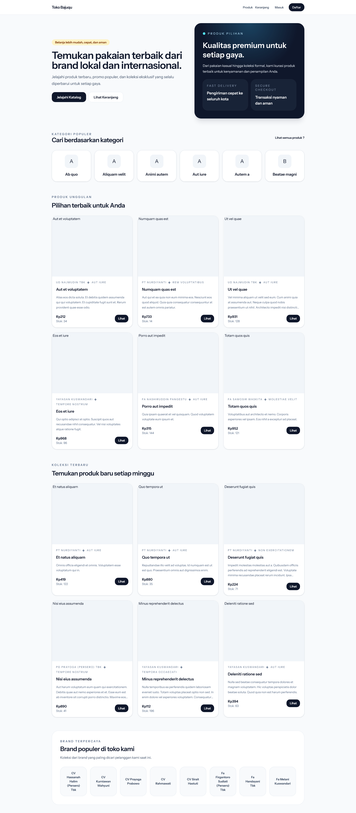

# Toko Bajuqu

<p align="center">
  
</p>

Aplikasi e-commerce toko pakaian yang lengkap dengan katalog produk, keranjang, checkout, dan panel admin berbasis Laravel 13 serta frontend Inertia.js + React.

## Fitur Utama

- Katalog produk dengan kategori, brand, dan varian.
- Keranjang belanja dan halaman checkout.
- Riwayat pesanan pengguna dan upload bukti pembayaran.
- Autentikasi pengguna dengan Laravel Fortify.
- Panel admin Filament untuk manajemen produk, transaksi, dan data terkait.

## Teknologi

- PHP 8.3
- Laravel 13
- Inertia.js + React
- Tailwind CSS v4
- Filament v5
- Laravel Fortify
- Laravel Wayfinder
- Spatie Laravel Permission

## Persyaratan

- PHP 8.3
- Composer
- Node.js + npm
- Database (MySQL, SQLite, atau lainnya sesuai konfigurasi `.env`)

## Instalasi

1. Clone repository:
    ```bash
    git clone <repo-url> toko-bajuqu
    cd toko-bajuqu
    ```
2. Pasang dependensi PHP:
    ```bash
    composer install
    ```
3. Salin file environment dan buat key aplikasi:
    ```bash
    cp .env.example .env
    php artisan key:generate
    ```
4. Atur koneksi database di file `.env`.
5. Jalankan migrasi dan seeder:
    ```bash
    php artisan migrate
    php artisan db:seed
    ```
6. Pasang dependensi frontend dan bangun aset:
    ```bash
    npm install
    npm run build
    ```

> Jika ingin menjalankan semua langkah otomatis, gunakan skrip `composer setup`.

## Menjalankan Aplikasi

- Jalankan server Laravel:
    ```bash
    php artisan serve
    ```
- Jalankan mode development Vite:
    ```bash
    npm run dev
    ```

## Skrip Penting

- `npm run dev` - jalankan dev server Vite
- `npm run build` - bangun aset frontend
- `npm run lint` - jalankan ESLint
- `npm run format` - jalankan Prettier
- `npm run types:check` - jalankan TypeScript check
- `composer test` - jalankan test dan pemeriksaan CI

## Struktur Utama

- `app/Models` - model Eloquent aplikasi
- `app/Http/Controllers` - controller web utama
- `app/Filament` - resource Filament untuk admin
- `resources/js` - halaman React/Inertia
- `routes/web.php` - rute web aplikasi
- `database/seeders` - seeder untuk data awal

## Seeder Default

Seeder utama akan membuat:

- Role & permission
- Data pengguna awal
- Kategori, brand, produk, varian
- Transaksi contoh

## Catatan

- Gunakan `.env.example` sebagai referensi konfigurasi.
- Untuk lingkungan Windows dengan Laragon, pastikan `PHP` dan `npm` tersedia di PATH.
- Jika terjadi error `Unable to locate file in Vite manifest`, jalankan ulang `npm run build`.
